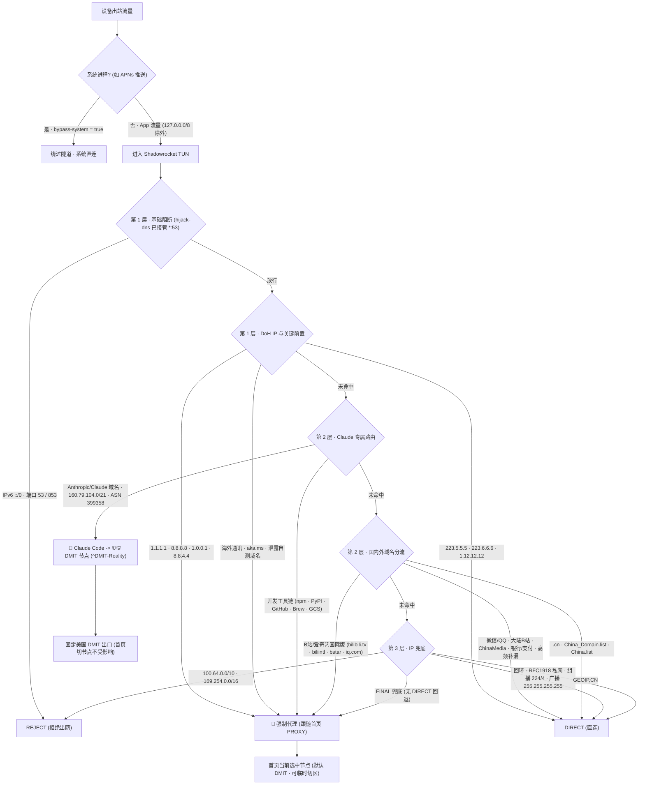
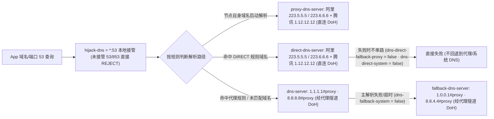

# shrc

个人 iOS **Shadowrocket** 常开配置，目标是在**长期开启代理**的前提下兼顾**国内高速直连**、**App 流量 DNS 不泄露**与 **Claude 独立固定出口**。

## 快速导入

主配置订阅地址（要求 Shadowrocket `>= 2.2.92`）：

```text
https://raw.githubusercontent.com/WANGXU-SU/shrc/refs/heads/main/shrc-revised.conf
```

### 仓库文件

| 文件 | 说明 |
| --- | --- |
| [shrc-revised.conf](shrc-revised.conf) | 主配置文件（当前唯一维护） |
| [README.md](README.md) | 架构说明、路由图、DNS 设计与自检清单 |

---

## 流量路由总览图

规则遵循**从上往下、第一条命中即生效**，分为**基础阻断与关键前置 → 域名分流 → IP 兜底**三层；未命中的流量统一进入 `FINAL,🚀 强制代理`，不设 `DIRECT` 回退。



---

## DNS 四路分工与防泄露架构

DNS 解析与流量去向严格绑定，所有配置均使用 **IP 字面量 DoH**（避免解析 DoH 主机名本身产生循环），并关闭系统 DNS 及直连向代理的跨路回退：



### DNS 参数明细

| 参数 | 配置值 | 作用与约束 |
| --- | --- | --- |
| `dns-server` | `https://1.1.1.1/dns-query#proxy,https://8.8.8.8/dns-query#proxy` | 代理域名及兜底解析，DoH 流量本身走隧道，ISP 看不到查询的海外域名 |
| `fallback-dns-server` | `https://1.0.0.1/dns-query#proxy,https://8.8.4.4/dns-query#proxy` | 主代理 DoH 故障时接管，同样强制经 `#proxy` 隧道 |
| `direct-dns-server` | `https://223.5.5.5/dns-query,https://1.12.12.12/dns-query,https://223.6.6.6/dns-query` | 直连域名专属，阿里 + 腾讯双厂商 DoH 互为容灾，保证国内 CDN 按本地位置调度（需 Shadowrocket `>= 2.2.92`） |
| `proxy-dns-server` | `https://223.5.5.5/dns-query,https://1.12.12.12/dns-query,https://223.6.6.6/dns-query` | 仅用于隧道建立前解析代理节点自身域名；若节点改为 IP + SNI 可消除此直连 |
| `dns-direct-fallback-proxy` | `false` | 国内 DoH 失败时不回退到代理 DNS，防止国内域名解析串去海外 |
| `dns-direct-system` / `dns-fallback-system` | `false` / `false` | 禁止直连与故障回退使用运营商系统 DNS |
| `hijack-dns` | `*:53` | 本地接管所有 IPv4 明文 53 查询，配合 `DST-PORT,53,REJECT` 与 `DST-PORT,853,REJECT` 杜绝明文/DoT 旁路 |

---

## 配置分节详解

### 1. `[General]` 与 `[MITM]` 核心参数

| 参数 | 当前值 | 设计意图 |
| --- | --- | --- |
| `bypass-system` | `true` | 让 iOS 系统进程（如 APNs 推送）走系统直连，减少后台耗电与推送延迟 |
| `skip-proxy` | `localhost,127.0.0.1` | 仅保留回环直连，不跳过苹果/银行/私网，避免绕过本机额外启用的小火箭模块或脚本 |
| `tun-excluded-routes` | `127.0.0.0/8` | 仅排除回环段，局域网流量仍经过规则表处理以兼容本机脚本与模块 |
| `ipv6` / `prefer-ipv6` | `false` / `false` | 禁用 IPv6 解析与优先，配合 `IP-CIDR6,::/0,REJECT` 防止 IPv6 旁路泄露 |
| `private-ip-answer` | `false` | 拒绝 DNS 返回私网 IP（防投毒）；目前内网服务建议通过纯 IP 访问，或自行改为 `true`/写 `[Host]` |
| `icmp-auto-reply` | `true` | 自动响应 ping 等 ICMP 测试 |
| `always-reject-url-rewrite` | `false` | 仅在“配置”路由模式下生效（当前未启用 URL Rewrite） |
| `udp-policy-not-supported-behaviour` | `REJECT` | 节点不支持 UDP 时直接拒绝而不回退 `DIRECT`；UDP 与 QUIC 按分流正常放行 |
| `[MITM] enable` | `false` | 关闭 HTTPS 解密，移除所有去广告重写、脚本及 `BlockHttpDNS.list`，避免破坏国内 App（如美团酒店、地图定位） |

### 2. `[Proxy Group]` 策略组

| 策略组 | 类型 | 成员 / 筛选规则 | 默认选项 | 用途与说明 |
| --- | --- | --- | --- | --- |
| `🚀 强制代理` | `select` | `PROXY, REJECT` | `PROXY` | 日常所有代理流量（含海外通讯、工具链、B 站国际版、`FINAL`），跟随首页当前选中的节点，不含 `DIRECT` |
| `🇺🇸 DMIT 节点` | `select` | `policy-regex-filter=^DMIT-Reality` | `DMIT-Reality-DMIT-main` | 按前缀正则从节点中精准筛出 DMIT 节点（避免误匹配其他机场含 `DMIT` 字样的节点） |
| `🧠 Claude Code` | `select` | `🇺🇸 DMIT 节点, REJECT` | `🇺🇸 DMIT 节点` | Claude 专属通道，不含 `PROXY` 和 `DIRECT`；即使首页切到日本或东南亚节点，Claude 出口依然固定为 DMIT |

### 3. `[Rule]` 三层分流与规则集清单

| 层级 | 规则类别 | 策略目标 | 核心内容与说明 |
| --- | --- | --- | --- |
| 第 1 层 | 基础阻断 | `REJECT` | `IP-CIDR6,::/0`、`DST-PORT,53`、`DST-PORT,853`（全部 IP/端口阻断均带 `no-resolve` 或端口直匹配） |
| 第 1 层 | DoH IP 路由前置 | `🚀 强制代理` / `DIRECT` | 海外 `1.1.1.1`、`8.8.8.8`、`1.0.0.1`、`8.8.4.4` 必走代理；国内 `223.5.5.5`、`223.6.6.6`、`1.12.12.12` 必走直连 |
| 第 1 层 | 海外通讯与泄露自测前置 | `🚀 强制代理` | `discord.com`/`discord.gg`/`discordapp.com`/`discord.media`、`signal.org`、`telegram.org`/`t.me`、`zoom.us`、`teams.microsoft.com`、`aka.ms`、`skype.com`、`slack.com`；以及 `browserleaks.com`、`dnsleaktest.com`、`ipleak.net`、`whatismyip.com`（防止被 `China_Domain.list` 误拉直连导致自测失真） |
| 第 2 层 | Claude 专属 | `🧠 Claude Code` | 内联 Anthropic/Claude 官方域名（`anthropic.com`、`claude.ai`、`claude.com`、`claudeusercontent.com`、`claudemcpcontent.com`、`claude.app`、`clau.de`、`claudemcpclient.com`、`servd-anthropic-website.b-cdn.net`、`anthropic.com.cdn.cloudflare.net`、`anthropic.auth0.com`、us5 Datadog intake）、自有网段 `160.79.104.0/21` 及 `IP-ASN,399358`（`no-resolve`） |
| 第 2 层 | 开发工具链 | `🚀 强制代理` | `npmjs.org`、`pypi.org`、`files.pythonhosted.org`、`github.com`、`githubusercontent.com`、`githubassets.com`、`formulae.brew.sh`、`storage.googleapis.com`（不占用 DMIT 专线，DMIT 维护时仍可更新配置） |
| 第 2 层 | 微信 / QQ | `DIRECT` | `WeChat.list`、`qq.com`（防异地登录风控） |
| 第 2 层 | 海外流媒体前置 | `🚀 强制代理` | 在所有国内列表前显式前置：`bilibili.tv`、`biliintl.com`、`biliintl.co`、`bstarstatic.com`、`p-bstarstatic.akamaized.net`、`upos-bstar-mirrorakam.akamaized.net`、`upos-bstar1-mirrorakam.akamaized.net`、`iq.com` |
| 第 2 层 | 大陆音视频与 CDN | `DIRECT` | `BiliBili.list`、`ChinaMedia.list`（440 条轻量规则，全带 `no-resolve`） |
| 第 2 层 | 银行 / 支付兜底 | `DIRECT` | 14 条非 `.cn` 银行与支付主域（`ccb.com`、`abchina.com`、`bankcomm.com`、`psbc.com`、`cmbchina.com`、`ecitic.com`、`cebbank.com`、`pingan.com`、`czbank.com`、`alipay.com`、`alipayobjects.com`、`tenpay.com`、`unionpay.com`、`95516.com`；`.cn` 银行域由后文 `DOMAIN-SUFFIX,cn` 覆盖） |
| 第 2 层 | 高频国内 App 补漏 | `DIRECT` | 补齐上游列表漏网导致触发跨洋 DoH 的域名：`dewu.com`、`poizon.com`、`larkoffice.com`、`kwimgs.com`、`ourwebpic.com`、`qcloudcdn.com`、`vivo.com`、`deepseek.com`、`kimi.com`、`doubao.com`、`baichuan-ai.com`、`minimax.chat`、`minimaxi.com`、`steamcontent.com`、`steamserver.net` |
| 第 2 层 | 大陆全量域名与特征 | `DIRECT` | `DOMAIN-SUFFIX,cn`、`China_Domain.list`（`DOMAIN-SET`）、`China.list`（`RULE-SET`） |
| 第 3 层 | 私网与组播/广播 | `DIRECT` | `127.0.0.0/8`、`10.0.0.0/8`、`172.16.0.0/12`、`192.168.0.0/16`、`224.0.0.0/4`、`255.255.255.255/32`（均 `no-resolve`，保留内网访问与 DLNA/AirPlay 投屏发现） |
| 第 3 层 | 特殊保留网段 | `REJECT` | `100.64.0.0/10`（CGNAT/Tailscale，如启用 Tailscale 可改 `DIRECT`）、`169.254.0.0/16`（链路本地） |
| 第 3 层 | IP 归属与最终兜底 | `DIRECT` / `🚀 强制代理` | `GEOIP,CN,DIRECT` → `FINAL,🚀 强制代理` |

#### 引用的外部规则集（均来自 `blackmatrix7/ios_rule_script`）

| 规则集 | 策略 | 用途 |
| --- | --- | --- |
| `WeChat/WeChat.list` | `DIRECT` | 微信核心域名、UA 与 ASN |
| `BiliBili/BiliBili.list` | `DIRECT` | 大陆 B 站域名与 CDN |
| `ChinaMedia/ChinaMedia.list` | `DIRECT` | 国内主流音视频与图床 CDN（440 条轻量规则，全带 `no-resolve`） |
| `China/China_Domain.list` | `DIRECT` | 国内常用域名纯域名表（`DOMAIN-SET`） |
| `China/China.list` | `DIRECT` | 国内关键字、常见客户端 UA 与云网段补充 |

### 4. `[Host]` 静态映射

- `localhost = 127.0.0.1`
- `localhost.weixin.qq.com = 127.0.0.1`

---

## 导入后必须检查

1. **版本与模式**：确认 Shadowrocket `>= 2.2.92`（低版本会忽略 `direct-dns-server`）。导入主配置后选中它，首页 **全局路由** 设为「配置」，日常节点选在常用代理节点（不能使用全局直连）。
2. **核对策略组**：进入底部 **配置 → 点本配置右侧 `i` → 代理分组**，确认：
   - `🇺🇸 DMIT 节点` 已选中 `DMIT-Reality-DMIT-main`
   - `🧠 Claude Code` 已选中 `🇺🇸 DMIT 节点`
   - `🚀 强制代理` 已选中 `PROXY`
3. **系统与 App 关键开关**：
   - 小火箭 **设置 → UDP → 打开「禁用 STUN」**（当前配置已移除规则层 UDP/STUN 拦截，此开关为 WebRTC 防泄露的核心防线；保持 mDNS 本地地址混淆开启）。
   - 系统 **设置 → Apple ID → iCloud → Private Relay → 关**，否则 Safari 会绕过小火箭直接出网。
   - 在设备可用时开启系统 VPN 设置中的 **包括所有网络 / Include All Networks**；关闭其他会覆盖本配置 DNS/规则的模块，更新后重启隧道。
4. **Claude 专项环境**：时区设为 `Los Angeles`、系统语言把 `English` 放第一位。用网页 Stripe 给 Claude 付款、Google 账号登录 Claude 或触发 Cloudflare 人机验证时，如首页当前切在非 DMIT 节点，建议临时切回 DMIT 保持出口 IP 一致。
5. **B 站国际版锁区提示**：B 站国际版（`bilibili.tv` / `biliintl` / `bstar`）走 `🚀 强制代理`（跟随首页节点）；遇到仅限东南亚版权的番剧时，在首页临时切到东南亚（如新加坡）节点即可，`🧠 Claude Code` 仍独立锁死 DMIT，互不干扰。
6. **请求日志验收**：检查 `api.anthropic.com`、`platform.claude.com`、`claude.ai` 是否命中 `🧠 Claude Code`（走 DMIT）；检查微信/国内站点是否命中 `DIRECT`；测试一个 CN IP 与非 CN IP 的 TCP 连接。
7. **断线无回退测试（重要）**：保持隧道开启，故意让所选节点不可达，确认 Claude、国外站点与代理 DNS 查询均失败且日志无 `DIRECT` 回退；恢复节点后再测。另需注意：隧道被关闭或崩溃时，配置文件本身无法拦截流量。
8. **三网切换与泄露自测**：在 Wi-Fi、蜂窝及切网后分别访问 `dnsleaktest.com`、`browserleaks.com/webrtc`、`ipleak.net`，代理域名下不应出现运营商 DNS 或 WebRTC 真实公网 IP（国内直连域名走阿里/腾讯 DoH 是预期行为，DNS 测试出现不同公共解析器出口 IP 不一定是泄露）。

---

## 设计取舍与已知限制

- **静态审查与真机验证**：当前配置逻辑已通过静态核对与远端规则交叉验证，实际设备的 `hijack-dns` 接管顺序、断线无回退及 DLNA/AirPlay 投屏仍需在真机请求日志中实测确认，不能仅凭文本声明“绝对零泄露”。
- **`bypass-system = true` 边界**：开启系统进程旁路能让推送（APNs）等系统服务走系统直连，更省电且不卡顿；代价是系统自身进程（非 App）的 DNS 查询会走本地网络，DNS 防泄露硬线仅约束经过小火箭的 App 流量。
- **保留最小 `skip-proxy` / `tun-excluded-routes`**：未将 RFC 1918 私网段放进 `tun-excluded-routes`，是为了避免流量绕过小火箭引擎而影响本机额外启用的模块或脚本；局域网与投屏通过第 3 层 `DIRECT` 规则放行，但 `private-ip-answer = false` 仅保障通过纯 IP 访问内网（如需内网域名解析私有 IP，请改为 `true` 或写入 `[Host]`）。若启用 Tailscale，需将 `100.64.0.0/10` 改为 `DIRECT`。
- **国内 DNS 不向代理回退**：国内直连由阿里 + 腾讯双厂商 DoH 兜底；仅当两家 DoH 同时不可用时国内域名解析直接失败，绝不串到海外代理 DNS。
- **UDP / WebRTC / 银行 App 限制**：UDP 与 QUIC 按分流放行，WebRTC 防泄露高度依赖小火箭内置「禁用 STUN」与浏览器策略，规则层面无法彻底拦截本地候选地址或指向 CN IP 的任意 TCP TURN。银行 App 虽走 `DIRECT`（解决出口 IP 问题），但本机仍可感知 `utun` VPN 接口存在，极端风控场景需临时关闭小火箭。
- **终端边界（手机 vs 电脑）**：配置仅对经过手机 Shadowrocket 的流量有效，不自动代理电脑/WSL 或稳定覆盖热点客户端；电脑端运行 Claude Code 请在该设备配置 `HTTP_PROXY`/`HTTPS_PROXY` 或 TUN（Claude Code 官方不支持 SOCKS URL），自定义 `ANTHROPIC_BASE_URL`/MCP 服务需另行加规则。

---

## 修订历史

| 日期 | 主要变更 |
| --- | --- |
| `2026-10-19` | 重构为三层分流架构，绑定国内外分流与 DoH，移除旧版冗余规则与去广告/MITM（后于 `10-20` 彻底清除 `BlockHttpDNS.list` 与 YouTube 重写/脚本） |
| `2026-10-22` | 放开全局 UDP 与 QUIC（解决手机 QQ 文件传输损坏），WebRTC 防泄露交由小火箭内置「禁用 STUN」承担 |
| `2026-10-28` | 将 RFC 1918 私网段从 `REJECT` 改为 `DIRECT`，恢复开着 VPN 访问路由器/NAS/内网网关 |
| `2026-11-21` | 删除废弃配置；新增 `🇺🇸 DMIT 节点` 独立锁定 Claude；移除外部 `claude.list` 与不用的 AI 规则；开启 `bypass-system = true`；接入腾讯 `1.12.12.12` DoH 容灾、`ChinaMedia.list` 与高频国内 App 补漏；前置泄露自测、B 站/爱奇艺国际版（含 `bstar` CDN）；组播/广播改 `DIRECT` |
